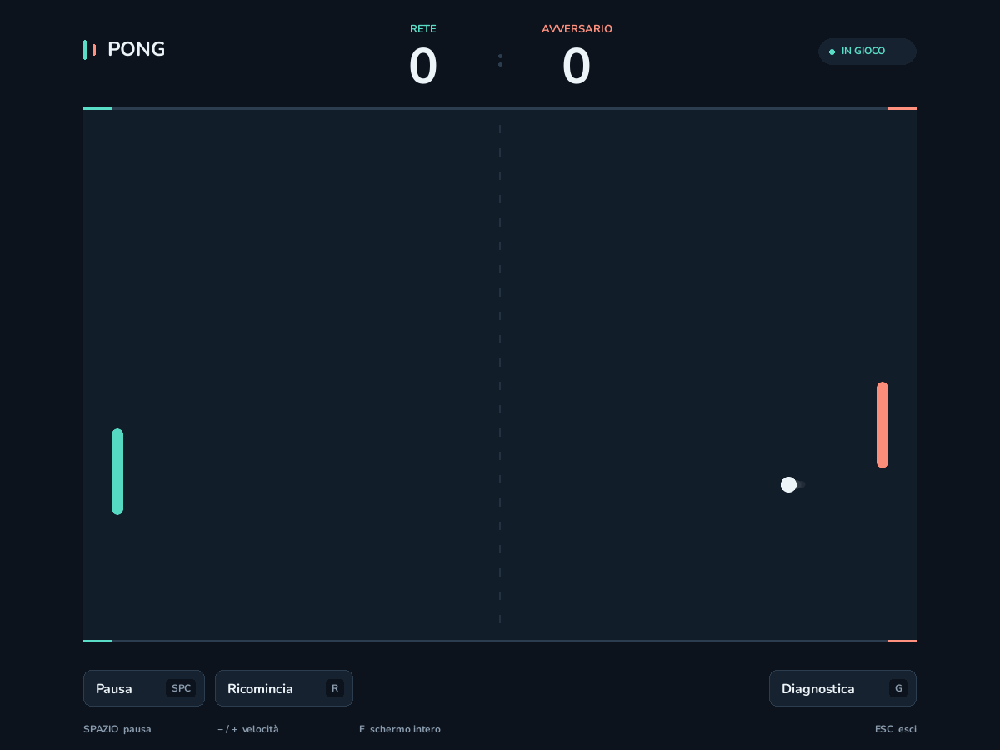
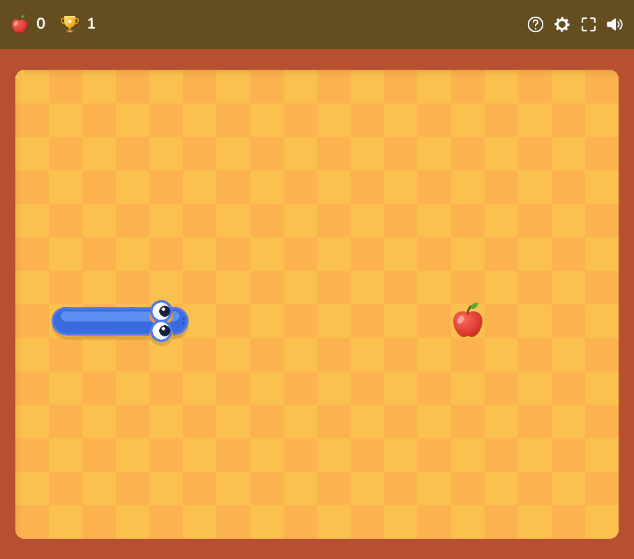

# NN Pong e Snake

[](https://github.com/chetto1983/NN-Pong/actions/workflows/tests.yml)

Due giochi automatici in Python e Pygame, controllati da reti ReLU con **pesi
costruiti analiticamente**: nessun training, nessun reinforcement learning.
I pesi sono scritti a mano a partire dall'algoritmo che devono eseguire.

L'idea nasce da [Sparks of Weight-Space Programming](https://rikiyat.github.io/blog/weight-space-programming/)
di Rikiya Takehi, Jayden Teoh, Alex Zhang e Omar Khattab. Questo progetto è una
dimostrazione indipendente ispirata al principio di esprimere un algoritmo nei
pesi di una rete; non riproduce i benchmark dell'articolo.

| Pong | Snake |
| --- | --- |
|  |  |

## Avvio rapido

Serve Python **3.12 o superiore**.

```bash
python -m venv .venv
# Linux/macOS
.venv/bin/python -m pip install -e .
.venv/bin/nn-pong
.venv/bin/nn-snake
```

```powershell
# Windows (PowerShell)
python -m venv .venv
.\.venv\Scripts\python.exe -m pip install -e .
.\.venv\Scripts\nn-pong.exe
.\.venv\Scripts\nn-snake.exe
```

Non serve attivare l'ambiente virtuale. In alternativa all'installazione come
pacchetto: `pip install -r requirements.txt` (versioni bloccate, usate dalla CI)
e poi `python pong.py` / `python snake.py`.

## Quanti parametri hanno le reti

Il conteggio comprende pesi e bias.

| Rete | Architettura | Pesi | Bias | Totale memorizzato | Equivalente denso |
| --- | --- | ---: | ---: | ---: | ---: |
| Pong | 2 → 2 → 2 → 1 | 10 | 5 | **15** | 15 |
| Snake, ciclo (baseline) | 2 → 18 → 4 → 4 | 124 | 26 | **150** | 150 |
| Snake, scorciatoie (predefinita) | 1008 → 955 → 28 → 11 → 20 → 4 | 6.148 | 1.018 | **7.166** | 991.006 |

La rete Snake con scorciatoie usa matrici sparse: 7.166 sono i coefficienti
memorizzati, zeri espliciti compresi; 991.006 è il conteggio con tutte le
connessioni allocate. Gli indici delle connessioni non sono inclusi.

I pesi Snake sono leggibili in [snake_classic.json](weights/snake_classic.json)
e [snake_shortcuts.json](weights/snake_shortcuts.json); quelli di Pong sono
costruiti in [pong_game/network.py](pong_game/network.py).

## Pong

Entrambe le racchette sono automatiche. La turchese è guidata dalla rete;
la corallo da una strategia deterministica di confronto, volutamente imprecisa.

### Cosa fa Python e cosa fa la rete

1. **Python** calcola il tempo all'impatto e l'intercetto grezzo
   `y = ball_y + ball_vy * t`, poi lo riduce modulo il periodo di riflessione
   `2*SPAN` (`wrap_period`). È questa riduzione a gestire un numero qualsiasi
   di rimbalzi sulle pareti.
2. **La rete** riceve la quota della racchetta e la coordinata ridotta:
   - un'unità nascosta, sempre attiva sul dominio, trasporta `y − paddle_y`;
   - un'unità *hinge* realizza l'unico ripiegamento del periodo (*fold*);
   - il secondo strato confronta il fold con la racchetta e applica una zona
     morta di 4 pixel;
   - l'uscita è il comando di movimento: positivo verso il basso.
3. **La simulazione** moltiplica l'uscita per un guadagno e ne limita la velocità.

Fuori dal dominio (`y` non ridotta o racchetta fuori campo) `forward` solleva
`ValueError` invece di restituire un comando sbagliato. La rete precedente,
2 → 8 → 2 → 1 con 45 parametri, produceva gli stessi comandi, ma 5 delle 8 unità
nascoste non si attivavano mai: lo stress test sotto dà risultati identici.

### Fisica

Velocità costante fra gli urti; collisioni calcolate al tempo esatto di contatto
fra il cerchio della palla e le racchette a capsula, anche a velocità che
supererebbero lo spessore della racchetta. Sulle racchette contano anche il loro
movimento e l'attrito tangenziale con spin. Passi fisici di 1/120 s con
interpolazione grafica. Dettagli e limiti in [docs/PONG_PHYSICS.md](docs/PONG_PHYSICS.md).

| Tasto | Azione |
| --- | --- |
| `Esc` | Esci |
| `Spazio` | Pausa / riprendi |
| `R` | Ricomincia la partita |
| `G` | Mostra / nascondi la diagnostica |
| `+` / `=` e `-` | Velocità della palla |
| `F` | Schermo intero / finestra |

### Verifica

```bash
python pong.py --test                                # rete contro la formula di riferimento, 50.000 campioni
python pong.py --headless --seeds 100 --frames 10000 # 1.000.000 di passi da 1/60 s, senza finestra
```

Risultato dello stress test: 3.019 respinte, **zero palle mancate** dalla rete,
punteggio aggregato 38–0. Attenzione: a questa velocità non manca nessuna palla
nemmeno una racchetta che segue la palla senza previsione, quindi il test non
distingue la rete da un controllore banale; la differenza appare da 2× la
velocità di servizio ([E1](docs/EXPERIMENTS.md#e1--rimbalzi-dentro-o-fuori-dalla-rete-pong)).
`--seeds` e `--frames` richiedono interi positivi.

## Snake

Campo 18×14. Il serpente parte da solo; le frecce possono solo riprendere una
pausa, la direzione è sempre decisa dalla rete.

- **Rete con scorciatoie (predefinita).** Riceve quattro mappe binarie (testa,
  mela, coda, corpo). Nei pesi sono codificati ostacoli, distanze sul ciclo e
  scelta delle scorciatoie; da metà campo occupato torna al ciclo per
  ricompattare il corpo. In partita esegue solo strati affini, ReLU e argmax,
  senza ricerca di percorsi né correzione esterna dell'azione.
  Costruzione in [docs/SNAKE.md](docs/SNAKE.md).
- **Baseline a ciclo** (`--policy cycle`). Vede solo la testa e percorre un
  ciclo hamiltoniano fisso. Descritta in [docs/SNAKE_BASELINE.md](docs/SNAKE_BASELINE.md).

La garanzia di completamento vale per i pesi costruiti, a partire dal corpo
iniziale sul ciclo; pesi modificati o stati arbitrari possono invalidarla.
La partita è vinta quando il serpente occupa tutte le 252 celle.

```bash
python snake.py                                   # finestra Pygame
python snake.py --test                            # verifica ogni cella del ciclo e una partita completa
python snake.py --headless --seeds 100            # 100 partite riproducibili (codice 1 se una perde)
python snake.py --compare --seeds 100             # rete con scorciatoie contro baseline
python snake.py --policy cycle                    # solo baseline
python snake.py --weights weights/snake_shortcuts.json
python snake.py --export-weights pesi.json
```

`--seed` imposta il primo seed, `--max-steps` il limite di mosse (default
100.000), `--json` produce statistiche leggibili da altri programmi.

| Tasto | Azione |
| --- | --- |
| `Spazio` | Pausa / riprendi |
| `R` | Nuova partita con lo stesso seed |
| `+` / `-` | Velocità, da 1 a 120 mosse al secondo |
| `G` | Mostra / nascondi il ciclo di riferimento |
| `H` o icona `?` | Aiuto |
| `F` o icona schermo intero | Cambia visualizzazione |
| Icone ingranaggio / altoparlante | Impostazioni / suono |
| `Esc` | Chiudi il pannello aperto oppure esci |

Il record locale è salvato in `~/.nn-pong/snake-record.json`; le simulazioni
headless non lo modificano.

### Risultati

| Seed | Baseline: mosse medie | Scorciatoie: mosse medie | Riduzione | Completamenti |
| --- | ---: | ---: | ---: | ---: |
| 0–99 | 15.465,24 | 8.369,72 | −45,88% | 100/100 per entrambe |
| 100–199 | 15.427,51 | 8.380,99 | −45,68% | 100/100 per entrambe |

Zero collisioni e 248 mele per partita in tutti i casi. Report JSON e
protocollo in [docs/benchmarks](docs/benchmarks/README.md). La rete con
scorciatoie è più grande e costa più CPU: il guadagno è nel numero di mosse.

## Esperimenti

[docs/EXPERIMENTS.md](docs/EXPERIMENTS.md) raccoglie cinque esperimenti
riproducibili (codice in [`experiments/`](experiments)): costo di spostare i
rimbalzi dentro la rete Pong, confronto con reti addestrate, robustezza a rumore
e precisione numerica, Snake contro un greedy e su altre dimensioni del campo,
costo della forma neurale. In breve: i pesi analitici danno esattezza e
garanzie di completamento che l'imitazione addestrata non raggiunge (0 vittorie
su 60 partite con il 95% di accuratezza), ma la rete Snake con scorciatoie non
regge errori relativi di 10⁻⁴ né bfloat16, e ogni decisione costa 10–100 volte
la stessa regola in Python.

## Sviluppo

```bash
python -m pip install -e ".[dev]"
python -m unittest discover -s tests -v   # include rendering con driver SDL "dummy"
ruff check .
```

La CI ([tests.yml](.github/workflows/tests.yml)) esegue lint, test e comandi
di verifica su Linux, Windows e macOS con Python 3.12 e 3.13.

```text
pong.py, snake.py        CLI (entry point nn-pong, nn-snake)
pong_game/               configurazione, rete, fisica, renderer di Pong
snake_game/              regole, reti, sprite disegnati in codice, renderer di Snake
snake_game/assets/       font Nunito (OFL)
weights/                 pesi Snake esportati
tests/                   test unitari, di regressione e di rendering
experiments/             esperimenti E1–E5 (risultati in docs/experiments/)
docs/                    costruzione delle reti, fisica, benchmark, esperimenti
```

## Licenza

Codice, pesi, immagini e documentazione: [BSD Zero Clause (0BSD)](LICENSE),
uso libero senza obbligo di attribuzione. Unica eccezione: il font Nunito in
`snake_game/assets/`, distribuito con la propria [SIL Open Font License](snake_game/assets/OFL-Nunito.txt).
Dettagli in [snake_game/assets/SOURCES.md](snake_game/assets/SOURCES.md).
